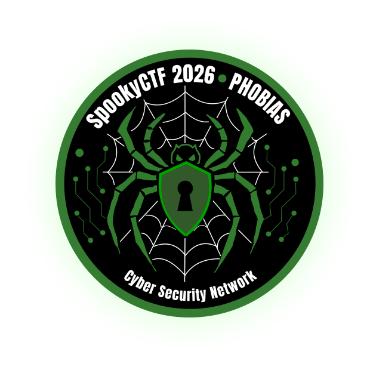

# SpookyCTF 2026 — Write-ups

  

This repository contains the write-ups and notes for the challenges solved by team **Cyberstup** (the official CTF team of Cybersup) during **SpookyCTF 2026**.

Together, we solved $32/42$ challenges across various categories over the course of the event.

---

## Our Team

| Team Member | Role | Score |
| --- | --- | --- |
| **J0s3ph_AAAAA** (me) | Team Captain | **2487** |
| **0xNyxvoid** | Member | **789** |
| **Fayde** | Member | **1229** |
| **Kylex** | Member | **600** |
| **Azaelias** | Member | **0** |
| **Yassxne** | Member | **0** |
| **Nyx.exe** | Member | **0** |
| **mouillekhiya** | Member | **0** |
| **WizZ** | Member | **75** |

---

## Categories & Solves

| Category | Solves |
| --- | --- |
| Rules | **1/1** |
| Forensics | **9/9** |
| Crypto | 8/11 |
| Misc | 3/6 |
| OSINT | 2/6 |
| BinRev | **6/6** |
| Web | **3/3** |
| **Total** | **32/42** |

Our team placed **82nd** out of 1051 participating teams (according to the Teams list on https://spooky.ctfd.io/teams) with **5,180 points**.

---

## Write-Ups

Below is the list of write-ups I've made, included in this repository:

### Forensics
- [Stash The Hash](forensics/stash-the-hash.md)
- [Eisoptrophobia](forensics/eisoptrophobia.md)
- [Arachnophobia](forensics/arachnophobia.md)
- [The Haunted Portrait](forensics/the-haunted-portrait.md)
- [The Phantom Login](forensics/the-phantom-login.md)
- [Phasmophobia](forensics/phasmophobia.md)
- [Peering Eyes](forensics/peering-eyes.md) (by Fayde !)

### Crypto
- [Heads will Roll](crypto/heads-will-roll.md)
- [I Feel Like Someone's Watching Me](crypto/i-feel-like-someones-watching-me.md)

### Misc
- [Demented Memories](misc/demented-memories.md)

---

## General Information

- **Event:** SpookyCTF 2026
- **Organizer:** NJIT Cyber Security Network (CSN)
- **Format:** Jeopardy-style Capture the Flag
- **Team:** Cyberstup (Cybersup's CTF Team)
- **Captain:** J0s3ph_AAAAA
- **Final Rank:** 82 / 1051 (5,180 pts)
- **Solves:** $32/42$
- **Links:** [SpookyCTF Website](https://spooky.ctfd.io/) | [CTFtime Event Page](https://ctftime.org/event/3339)
